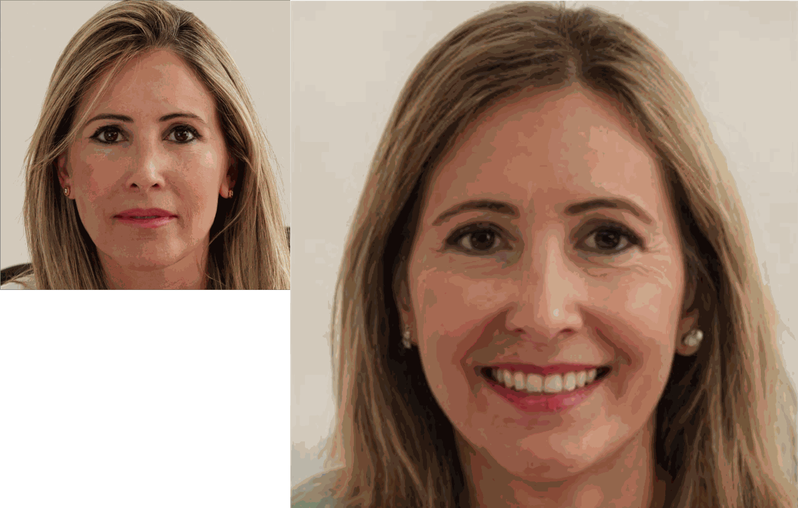
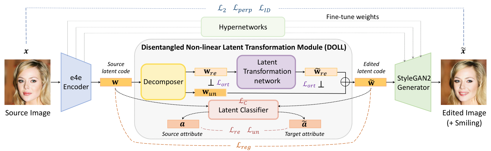
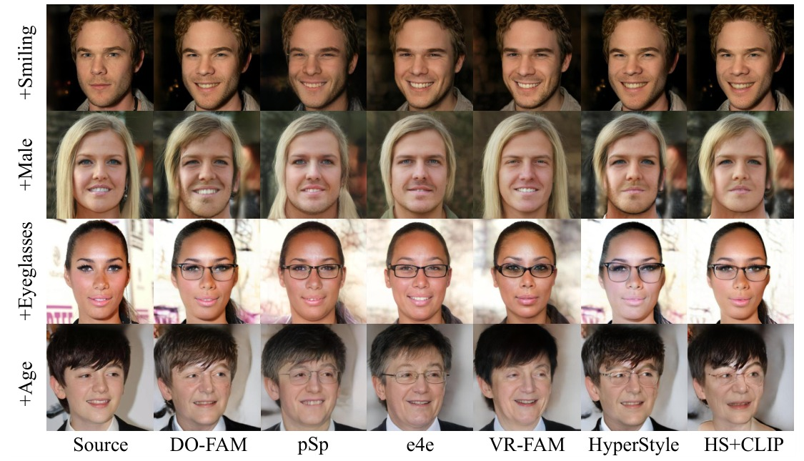
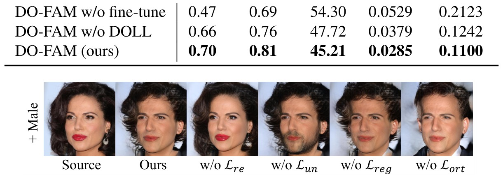

<div align="center">

# DO-FAM: Disentangled Non-Linear Latent Navigation for Facial Attribute Manipulation

[**Yifan Yuan**](https://yifanyuan.com)<sup>1*</sup> · **Siteng Ma**<sup>1*</sup> · **Hongming Shan**<sup>2</sup> · **Junping Zhang**<sup>1&dagger;</sup>

<sup>1</sup>Shanghai Key Lab of Intelligent Information Processing, School of Computer Science, Fudan University
<br>
<sup>2</sup>Institute of Science and Technology for Brain-inspired Intelligence, Fudan University
<br>
<sup>*</sup>Equal contribution &emsp; <sup>&dagger;</sup>Corresponding author

**ICASSP 2023**

<a href="https://doi.org/10.1109/ICASSP49357.2023.10095959"></a>
<a href="https://github.com/Sherlockyyf/VR-FAM"></a>
<a href="#-gradio-demo"></a>
<a href="https://pytorch.org"></a>
<a href="LICENSE"></a>

[English](README.md) · [简体中文](README_zh.md)



</div>

**TL;DR:** Real facial attribute editing needs both **high reconstruction quality** and **high irrelevance preservation**. DO-FAM fine-tunes the StyleGAN2 generator per image with hypernetworks (HyperStyle) for faithful reconstruction, and edits latent codes with **DOLL**, a *Disentangled nOn-Linear Latent transformation module* that splits a code into attribute-related and attribute-unrelated parts and only navigates the former — non-linearly, under the guidance of a latent classifier. DO-FAM extends our [VR-FAM](https://github.com/Sherlockyyf/VR-FAM) (ICASSP 2022).

## 🔍 Method

<p align="center"></p>

DO-FAM = encoder + **DOLL** + fine-tuned StyleGAN2 generator.

- **Generator fine-tuning (Sec. 2.2).** An e4e encoder gives the initial code $\hat{w}_{init}$; HyperStyle hypernetworks predict per-layer weight offsets $\Delta_\ell$ so that $G(\hat{w}_{init}; \hat{\theta})$ faithfully reconstructs the input (iterative refinement, $\mathcal{L}_2 + \lambda_{perp}\mathcal{L}_{perp} + \lambda_{ID}\mathcal{L}_{ID}$).
- **DOLL (Sec. 2.1).** A *decomposer* $P$ factorises a code into $w_{re} = P(w)$ and $w_{un} = w - P(w)$; the non-linear *latent transformation network* (LTNet) $T$ navigates the attribute-related part, $\tilde{w} = w_{un} + w_{re} + \alpha\,(T(w_{re}) - w_{re})$; a pre-trained *latent classifier* $C$ guides the navigation. DOLL is trained with
  $\mathcal{L}_{DOLL} = \mathcal{L}_{re} + \lambda_{un}\mathcal{L}_{un} + \lambda_{reg}\mathcal{L}_{reg} + \lambda_{ort}\mathcal{L}_{ort}$:
  correct target attribute ($\mathcal{L}_{re}$), unchanged unrelated attributes weighted by attribute correlations ($\mathcal{L}_{un}$), small latent changes ($\mathcal{L}_{reg}$) and orthogonality between $w_{un}$ and $w_{re}$, $T(w_{re})$ ($\mathcal{L}_{ort}$).

## 🛠️ Installation

```bash
git clone https://github.com/Sherlockyyf/DO-FAM.git
cd DO-FAM
conda env create -f environment.yml && conda activate dofam      # or: pip install -r requirements.txt
```

All StyleGAN2 operators are pure PyTorch — no C++/CUDA extension has to be compiled.

## 📦 Pretrained Models and Test Data

Put the models into `pretrained_models/` (DOLL modules into `pretrained_models/DOLL/`).

| Model | Description | Download |
|:-|:-|:-:|
| DOLL | DOLL modules for *Smiling, Gender (Male), Eyeglasses, Age (Young)* | [Google Drive](https://drive.google.com/drive/folders/1N2B1UFjqwRNK5ZydCIa_6QEYKiH6PGYE) |
| `hyperstyle_ffhq.pt` | HyperStyle (hypernetwork + StyleGAN2 generator) released by [HyperStyle](https://github.com/yuval-alaluf/hyperstyle) | [Google Drive](https://drive.google.com/file/d/1C3dEIIH1y8w1-zQMCyx7rDF0ndswSXh4/view) |
| `faces_w_encoder.pt` | W-encoder for the initial inversion, released by HyperStyle | [Google Drive](https://drive.google.com/file/d/1M-hsL3W_cJKs77xM1mwq2e9-J0_m7rHP/view) |
| latent classifier | latent classifier on HyperStyle codes (40 attributes), **only needed for training** | [Google Drive](https://drive.google.com/drive/folders/1YWxoMKx6k9XCZZfCLJNSIUYOH0JNLgFF) |
| test data | 30 CelebA-HQ test images with latent codes and weight offsets | [Google Drive](https://drive.google.com/drive/folders/1DkDyM_kHJrKjo4C37irwdrEWnZpNfK2C) |
| `CurricularFace_Backbone.pth` | identity metric (evaluation only) | [HyperStyle](https://github.com/yuval-alaluf/hyperstyle#auxiliary-models) |

A DOLL module is a 3-layer MLP on the 9216-d W+ code (~2 GB each in fp32); `--max_loaded` controls how many stay in memory.

## 🚀 Quick Start

**Edit the released test data** (pre-computed latent codes + HyperStyle weight offsets):

```bash
python scripts/edit.py --latents test_data/latent_codes --deltas test_data/weight_deltas \
    --doll_dir pretrained_models/DOLL --attr Smiling --alphas -1.5 -1 -0.5 0.5 1 1.5 --output outputs/smiling
```

**Edit your own images.** Faces must be aligned like FFHQ (`scripts/invert.py --align` does it with dlib). HyperStyle inversion runs on the fly:

```bash
python scripts/edit.py --images path/to/aligned_faces --doll_dir pretrained_models/DOLL \
    --attr Eyeglasses --alphas 1 2 3 4 --output outputs/eyeglasses

# sequential editing: every column adds one attribute
python scripts/edit.py --images path/to/aligned_faces --doll_dir pretrained_models/DOLL \
    --edits "Smiling=1.5,Eyeglasses=2,Age=3,Gender=3" --output outputs/sequential
```

For lower GPU memory, inversion and editing can be split (`invert.py` writes latent codes and weight offsets, ~200 MB per image in fp32, `--half_deltas` halves it):

```bash
python scripts/invert.py --input path/to/aligned_faces --output inversion/mine --save_reconstruction
python scripts/edit.py --latents inversion/mine/latents --deltas inversion/mine/weight_deltas \
    --doll_dir pretrained_models/DOLL --attr Age --alphas -4 -2 2 4 --output outputs/age
```

<details>
<summary><b>Python API</b></summary>

```python
import torch
from PIL import Image
from dofam.data import encoder_transforms
from dofam.editor import DOLLEditor
from dofam.hyperstyle import load_hyperstyle, run_inversion
from dofam.utils import tensor2im

net = load_hyperstyle('pretrained_models/hyperstyle_ffhq.pt', 'pretrained_models/faces_w_encoder.pt', device='cuda')
editor = DOLLEditor('pretrained_models/DOLL', device='cuda', edit_layers=11)

x = encoder_transforms(train=False)(Image.open('face.png').convert('RGB')).unsqueeze(0).cuda()
recon, w, deltas = run_inversion(x, net, n_iters=5)            # w: [1, 18, 512]
deltas = [None if d is None else d[0] for d in deltas]
w_edit = editor.sequential_edit(w, [('Smiling', 1.5), ('Eyeglasses', 2.0)])
with torch.no_grad():
    image, _ = net.decoder([w_edit], input_is_latent=True, randomize_noise=False, weights_deltas=deltas)
tensor2im(image[0]).save('edited.png')
```
</details>

### 🤗 Gradio Demo

```bash
python app.py --doll_dir pretrained_models/DOLL      # http://127.0.0.1:7860, add --share for a public link
```

## 🏋️ Training

Following the paper, the encoder and generator are taken from HyperStyle and kept fixed; the latent classifier is trained first, then one DOLL per attribute.

```bash
# 1) HyperStyle codes of the CelebA-HQ training images (latent codes only)
python scripts/invert.py --input data/celeba_hq/train --output inversion/celeba_hq_train --no_deltas

# 2) attribute labels aligned with the codes (CelebAMask-HQ annotation)
python scripts/prepare_celebahq_labels.py --anno data/CelebAMask-HQ/CelebAMask-HQ-attribute-anno.txt \
    --images_dir data/celeba_hq/train --output inversion/celeba_hq_train/labels.npy

# 3) latent classifier: 20 epochs, batch 256, Adam 1e-4  (or download ours)
python scripts/train_classifier.py --latents inversion/celeba_hq_train/latents.npy \
    --labels inversion/celeba_hq_train/labels.npy --exp_dir experiments/classifier --opts train_ratio=1.0

# 4) DOLL: 20 epochs, batch 16, Adam 1e-4, lambda_un=1, lambda_reg=100, lambda_ort=1  (configs/doll.yaml)
python scripts/train_doll.py --latents inversion/celeba_hq_train/latents.npy \
    --labels inversion/celeba_hq_train/labels.npy --classifier experiments/classifier/latent_classifier.pth \
    --exp_dir experiments/doll --attributes Smiling Male Eyeglasses Young
```

`ort_mode: gram` (default) reproduces the orthogonality loss of the released models (inner products over all pairs in the batch); `ort_mode: elementwise` is the per-sample form of Eq. (5).

## 📊 Evaluation

```bash
python scripts/edit.py --latents ... --deltas ... --doll_dir pretrained_models/DOLL --attr Smiling --alphas 1.5 \
    --save_individual --output outputs/eval                    # writes outputs/eval/Smiling_1.5/
python scripts/evaluate.py --source_dir data/celeba_hq/test --result_dir outputs/eval/Smiling_1.5 \
    --metrics id msssim fid l2 lpips
```

<details open>
<summary><b>Quantitative comparison on CelebA-HQ (from the paper)</b></summary>

| Attribute | Method | ID ↑ | SSIM (×0.1) ↑ | FID ↓ | L2 (×0.01) ↓ | LPIPS (×0.01) ↓ |
|:-|:-|:-:|:-:|:-:|:-:|:-:|
| Smiling | pSp | 0.52 | 7.03 | 52.61 | 4.89 | 18.56 |
| | e4e | 0.48 | 6.83 | 54.77 | 5.60 | 21.60 |
| | VR-FAM | 0.47 | 6.91 | 55.09 | 5.27 | 21.18 |
| | HyperStyle | 0.67 | 7.74 | 47.76 | 3.44 | 12.04 |
| | HyperStyle + StyleCLIP | 0.68 | 8.01 | 46.69 | **2.82** | **10.96** |
| | **DO-FAM** | **0.70** | **8.07** | **45.21** | 2.85 | 11.00 |
| Gender | HyperStyle + StyleCLIP | 0.56 | 7.42 | 54.25 | 6.15 | 16.68 |
| | **DO-FAM** | **0.62** | **7.44** | **53.06** | **5.09** | **15.20** |
| Eyeglasses | HyperStyle + StyleCLIP | 0.55 | 6.74 | **65.75** | 7.61 | 20.66 |
| | **DO-FAM** | **0.59** | **7.38** | 66.79 | **4.25** | **16.00** |
| Age | HyperStyle + StyleCLIP | 0.47 | 7.47 | 53.31 | **4.66** | 15.08 |
| | **DO-FAM** | **0.59** | **7.49** | **49.02** | 5.32 | **14.12** |

See Table 1 of the paper for all baselines on every attribute.
</details>

<p align="center"><br><em>Qualitative comparison on CelebA-HQ.</em></p>

<p align="center"><br><em>Ablation on the loss terms of Eq. (9) (+ Male).</em></p>

## 📁 Repository Structure

```text
dofam/
├── models/
│   ├── doll.py                # DOLL: decomposer + LTNet
│   ├── latent_classifier.py   # latent attribute classifier C
│   └── stylegan2/             # StyleGAN2 generator with HyperStyle weight offsets (pure PyTorch ops)
├── hyperstyle/                # minimal HyperStyle inference (hypernetwork, W-encoder, iterative refinement)
├── trainers/doll_trainer.py   # DOLL training (Eq. 5-9)
├── losses.py · editor.py · metrics.py · data.py · alignment.py
scripts/                       # invert · prepare_celebahq_labels · train_classifier · train_doll · edit
                               # evaluate · make_gif
configs/                       # doll.yaml · classifier.yaml
app.py                         # Gradio demo
```

## 📝 Citation

```bibtex
@inproceedings{yuan2023dofam,
  title     = {{DO-FAM}: Disentangled Non-Linear Latent Navigation for Facial Attribute Manipulation},
  author    = {Yuan, Yifan and Ma, Siteng and Shan, Hongming and Zhang, Junping},
  booktitle = {IEEE International Conference on Acoustics, Speech and Signal Processing (ICASSP)},
  year      = {2023},
  doi       = {10.1109/ICASSP49357.2023.10095959}
}

@inproceedings{yuan2022vrfam,
  title     = {{VR-FAM}: Variance-Reduced Encoder with Nonlinear Transformation for Facial Attribute Manipulation},
  author    = {Yuan, Yifan and Ma, Siteng and Zhang, Junping},
  booktitle = {IEEE International Conference on Acoustics, Speech and Signal Processing (ICASSP)},
  pages     = {1755--1759},
  year      = {2022}
}
```

## 📄 License

[MIT](LICENSE). Third-party code keeps its original license (see `licenses/`).
